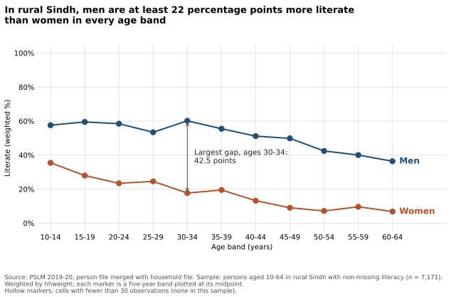

# ECO346 Assignment 1: Education Spending and Literacy in Rural Sindh

**Student:** FA24-BEDS-042 | **Section:** B | **Course:** Data Visualization Techniques for Economists, COMSATS University Islamabad, Lahore Campus

**Variant 2: Sindh rural.** The registration number ends in 42, and 42 = 5 x 8 + 2, so the remainder is 2. Only persons living in rural Sindh (`prov_code` = 3, `urban_rural` = 1) are used.

## Contents

1. [Repository and how to reproduce](#1-repository-and-how-to-reproduce)
2. [The distribution: education spending](#2-the-distribution-education-spending)
3. [The relationship: literacy by age and sex](#3-the-relationship-literacy-by-age-and-sex)
4. [The makeover: default and redesign](#4-the-makeover-default-and-redesign)
5. [A second language: Python](#5-a-second-language-python)
6. [Presentation](#6-presentation)

## Data and definitions

- **Source:** Pakistan Bureau of Statistics, PSLM 2019-20 (`data/pslm_person_subset.csv`, `data/pslm_hh_subset.csv`).
- **Merge:** the person file has no weight, province or area, so `hhweight`, `prov_code` and `urban_rural` are attached from the household file by `hhid`.
- **Weights:** every statistic is weighted by `hhweight`. A weighted mean is sum(w x) / sum(w).
- **Weighted quantile:** sort by x, compute the cumulative share of weight, and take the smallest x whose share reaches or exceeds p. R's built-in `quantile()` is not used.
- **Students (Question 2):** persons in the variant with `ed_total` > 0 (annual spending on that person's education, in rupees).
- **Literacy sample (Questions 3 to 5):** persons in the variant aged 10-64 with non-missing `literate`.
- **Age bands:** five years wide, 10-14 to 60-64 (eleven bands), plotted at their midpoints (12, 17, ..., 62). A cell with fewer than 30 unweighted observations is thin.

## 1. Repository and how to reproduce

```
ECO346-A1-FA24-BEDS-042/
|-- README.md                        this file
|-- data/
|   |-- pslm_person_subset.csv
|   `-- pslm_hh_subset.csv
|-- scripts/
|   |-- 01_default.R                 default scatterplot (Question 4)
|   |-- 02_distribution.R            weighted histogram (Question 2)
|   |-- 03_literacy.R                literacy figure and band table (Questions 3, 4)
|   `-- 04_second_language.py        Python band table and figure (Question 5)
|-- figures/
|   |-- default.svg
|   |-- distribution.svg
|   |-- literacy_by_age.svg
|   `-- literacy_by_age_python.svg
|-- tables/
|   |-- band_table_R.csv
|   `-- band_table_python.csv
`-- slides/
    `-- FA24-BEDS-042.pptx
```

Run the scripts in order, from the repository root. No internet connection is needed: they read the local copies in `data/`, and every figure is saved as SVG by the script that draws it.

```
Rscript scripts/01_default.R
Rscript scripts/02_distribution.R
Rscript scripts/03_literacy.R
python scripts/04_second_language.py
```

Requirements: R with `ggplot2`, `svglite` and `dplyr`; Python with `pandas`, `numpy` and `matplotlib`.

## 2. The distribution: education spending


*Script: `scripts/02_distribution.R`. Weighted histogram on a log scale with bins 0.1 wide in log10 units from 2.0 to 6.0 (Rs 100 to Rs 1,000,000). The vertical axis is density per log10 unit. Dashed lines mark the weighted median and the weighted 90th percentile.*

| Statistic | Value |
|---|---|
| Number of students | 1,440 |
| Weighted median | Rs 4,500 |
| Unweighted median | Rs 4,295 |
| Weighted 10th percentile | Rs 1,000 |
| Weighted 90th percentile | Rs 15,500 |
| Ratio of 90th to 10th percentile | 15.50 |
| Students excluded from the histogram (outside Rs 100 to Rs 1,000,000) | 1 |

**What the figure shows (71 words).** Spending is concentrated in the low thousands of rupees with a long right tail: the middle 80% of students lie between Rs 1,000 and Rs 15,500, a 15.5-fold spread. The weighted median (Rs 4,500) is about 5% above the unweighted (Rs 4,295) because households sampled at higher rates, which carry small weights, spend somewhat less (median Rs 4,000 in the lowest-weight third). Weighting undoes that over-representation, but the gap is small.

## 3. The relationship: literacy by age and sex


*Script: `scripts/03_literacy.R`. Weighted literacy rate (0 to 100 percent) against age band, plotted at band midpoints, with women and men as two series of markers joined by lines. Series are labelled directly at their ends, and the band with the largest gap is annotated. Hollow markers would mark thin cells; none occur here because the smallest cell has 77 observations.*

Literacy sample: 7,171 persons. `n` is the unweighted number of persons; rates are weighted percentages. Full table in `tables/band_table_R.csv`.

| Band | Midpoint | Women n | Women literate (%) | Men n | Men literate (%) | Gap (points) |
|---|---|---|---|---|---|---|
| 10-14 | 12 | 529 | 35.5 | 718 | 57.6 | 22.1 |
| 15-19 | 17 | 446 | 28.0 | 548 | 59.5 | 31.5 |
| 20-24 | 22 | 455 | 23.4 | 422 | 58.5 | 35.1 |
| 25-29 | 27 | 430 | 24.6 | 419 | 53.4 | 28.9 |
| 30-34 | 32 | 399 | 17.7 | 382 | 60.2 | 42.5 |
| 35-39 | 37 | 319 | 19.5 | 391 | 55.5 | 36.0 |
| 40-44 | 42 | 285 | 13.2 | 274 | 51.2 | 38.0 |
| 45-49 | 47 | 198 | 9.1 | 221 | 49.9 | 40.8 |
| 50-54 | 52 | 152 | 7.2 | 208 | 42.4 | 35.3 |
| 55-59 | 57 | 98 | 9.6 | 100 | 40.0 | 30.4 |
| 60-64 | 62 | 77 | 6.8 | 100 | 36.4 | 29.6 |

**Key numbers**

| | Women | Men |
|---|---|---|
| Aged 15-19 | 28.0% | 59.5% |
| Aged 55-59 | 9.6% | 40.0% |

The band with the largest gap is **30-34**, where men lead women by 42.5 percentage points.

**Interpretation (82 words).** Men are far more literate than women in every band, and the gap barely narrows with youth: 31.5 points at 15-19 against 30.4 at 55-59, peaking at 42.5 at 30-34. Women's literacy falls from 28% to under 10% across the age range. Because this is one cross-section, older bands are older birth cohorts, so the slope mixes age and generation. The figure cannot tell us why: scarce girls' schools (supply) and household decisions not to send girls (demand) produce the same picture.

## 4. The makeover: default and redesign

| Default (R, nothing added) | Redesign (Question 3) |
|---|---|
|  |  |

*The default is `ggplot(data, aes(age, literate)) + geom_point()` on the literacy sample, produced by `scripts/01_default.R` and committed before the redesign.*

**Explanation of the redesign (112 words).** Three changes. (1) Conditional means: the default draws 7,171 binary points on two rows that overplot completely (Chapter 4, overplotting); I plot the weighted mean of literate in five-year bands, E[literate | age], read by position on a common scale (Chapter 1, Cleveland-McGill hierarchy). (2) Women and men are separate lines labelled at their ends with no legend (Gestalt proximity, data-ink). (3) hhweight makes the rates describe rural Sindh, not the sample (Chapter 3, whose distribution), and hollow markers flag thin cells; the title states the finding. The default shows what the redesign hides: individual observations at single years of age, so the spread inside each band; the redesign shows only means.

## 5. A second language: Python



*Script: `scripts/04_second_language.py`. It recomputes the band table (`tables/band_table_python.csv`) and redraws the Question 3 figure. When `tables/band_table_R.csv` exists, the script compares the two tables and reports the largest difference.*

| Women aged 15-19 | Literacy rate |
|---|---|
| From R | 28.0% |
| From Python | 28.0% |

The two band tables agree to one decimal place.

**A default that differed (62 words).** ggplot2 pads a scale's limits by 5% on each side, so limits of 0-100 display as about -5 to 105; matplotlib's set_ylim(0, 100) adds no padding, so the Python figure looked tighter. I set ylim(-5, 105) and xlim(10, 70) explicitly to match R. I also built bands with floor(age/5)*5 in both languages rather than cut(), whose default closes intervals on the right.

## 6. Presentation

Slides: [`slides/FA24-BEDS-042.pptx`](slides/FA24-BEDS-042.pptx), four slides covering the variant, the makeover (default and redesign side by side), and the most important finding: the gender gap in literacy has barely narrowed, at 31.5 points among those aged 15-19 and 30.4 points among those aged 55-59.
